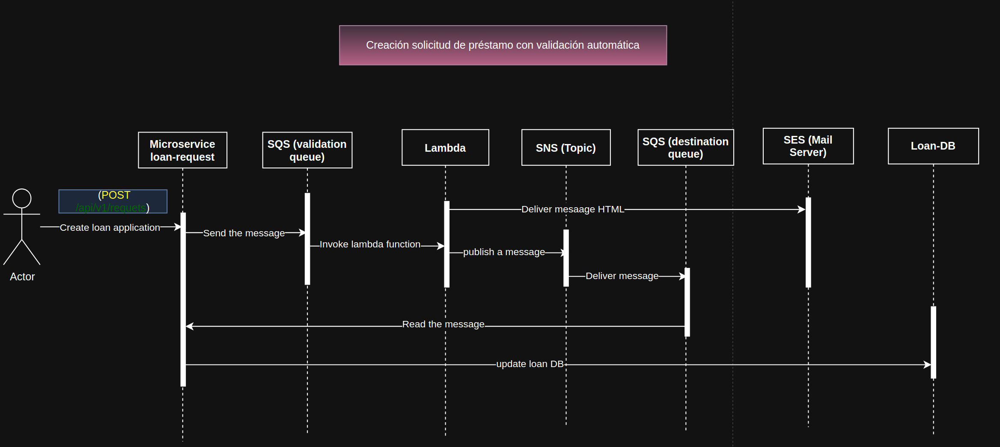
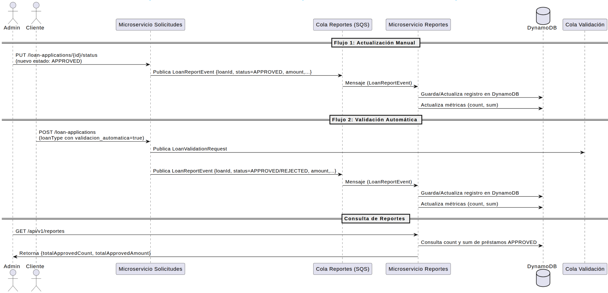
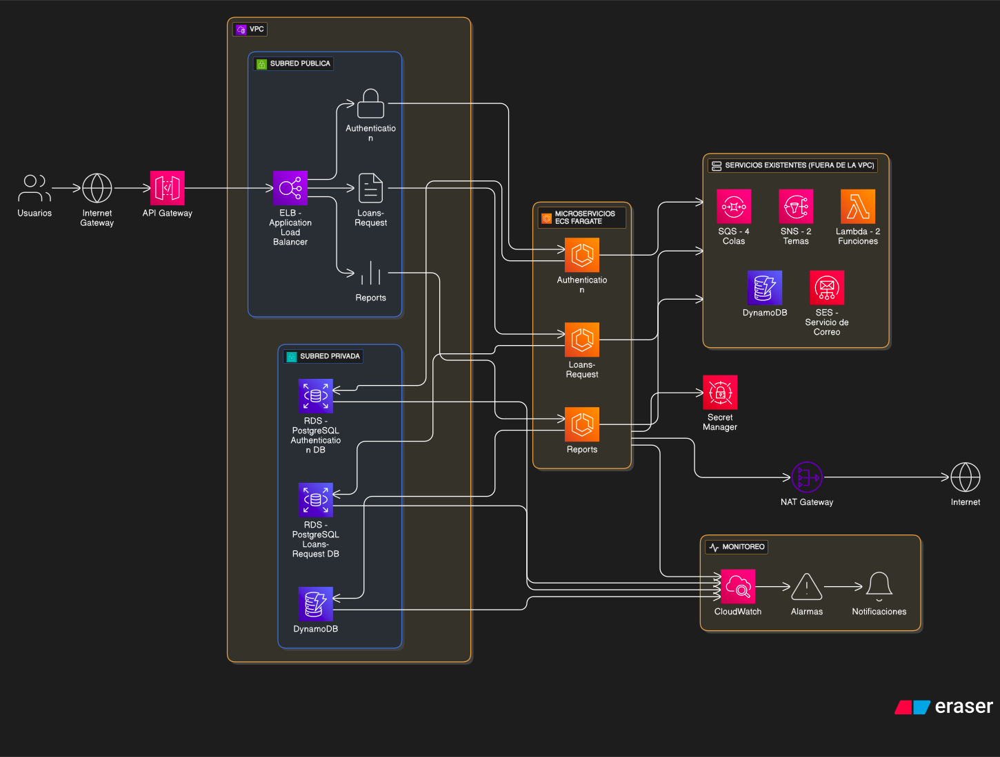

# Enunciado e Historias de Usuario Del Reto Bootcamp 
## Proyecto "CrediYa"

- **Información**:
https://docs.google.com/spreadsheets/d/1CUuskO2iTXHTEY2jRpdQ8SKzHrS9VUxlZGPjsvWRPDY/edit?gid=1479050755#gid=1479050755


# Proyecto Base Implementando Clean Architecture

## Antes de Iniciar

Empezaremos por explicar los diferentes componentes del proyectos y partiremos de los componentes externos, continuando con los componentes core de negocio (dominio) y por último el inicio y configuración de la aplicación.

Lee el artículo [Clean Architecture — Aislando los detalles](https://medium.com/bancolombia-tech/clean-architecture-aislando-los-detalles-4f9530f35d7a)

# Arquitectura


## Domain

Es el módulo más interno de la arquitectura, pertenece a la capa del dominio y encapsula la lógica y reglas del negocio mediante modelos y entidades del dominio.

## Usecases

Este módulo gradle perteneciente a la capa del dominio, implementa los casos de uso del sistema, define lógica de aplicación y reacciona a las invocaciones desde el módulo de entry points, orquestando los flujos hacia el módulo de entities.

## Infrastructure

### Helpers

En el apartado de helpers tendremos utilidades generales para los Driven Adapters y Entry Points.

Estas utilidades no están arraigadas a objetos concretos, se realiza el uso de generics para modelar comportamientos
genéricos de los diferentes objetos de persistencia que puedan existir, este tipo de implementaciones se realizan
basadas en el patrón de diseño [Unit of Work y Repository](https://medium.com/@krzychukosobudzki/repository-design-pattern-bc490b256006)

Estas clases no puede existir solas y debe heredarse su compartimiento en los **Driven Adapters**

### Driven Adapters

Los driven adapter representan implementaciones externas a nuestro sistema, como lo son conexiones a servicios rest,
soap, bases de datos, lectura de archivos planos, y en concreto cualquier origen y fuente de datos con la que debamos
interactuar.

### Entry Points

Los entry points representan los puntos de entrada de la aplicación o el inicio de los flujos de negocio.

## Application

Este módulo es el más externo de la arquitectura, es el encargado de ensamblar los distintos módulos, resolver las dependencias y crear los beans de los casos de use (UseCases) de forma automática, inyectando en éstos instancias concretas de las dependencias declaradas. Además inicia la aplicación (es el único módulo del proyecto donde encontraremos la función “public static void main(String[] args)”.

**Los beans de los casos de uso se disponibilizan automaticamente gracias a un '@ComponentScan' ubicado en esta capa.**

## 📖 Documentación del API

La documentación del API se genera automáticamente con **springdoc-openapi**.

- **Swagger UI (interfaz gráfica):**  
  👉 [http://localhost:8080/swagger-ui.html](http://localhost:8080/swagger-ui.html)

- **OpenAPI JSON (especificación en formato JSON):**  
  👉 [http://localhost:8080/v3/api-docs](http://localhost:8080/v3/api-docs)

## 📖 Diagramas de secuencia y de infraestuctura de AWS
- HU-07 -> Agregar al sistema prestamo con validación automatica
    
- HU-08-09 -> Mostrar Cantidad de prestamos Y Mostrar Monto total de prestamo
    
- HU-10 -> Despliegue de la solución
    

## Notas Importantes
### 📌 Inyección de beans en los casos de uso (Clean Architecture + Plugin Bancolombia)
En el enfoque de **Arquitectura Limpia** con el plugin de Bancolombia, los **casos de uso** (capa usecase) deben permanecer independientes de frameworks (Spring, R2DBC, etc). Esto significa que no podemos inyectar directamente beans del framework, como TransactionalOperator o R2dbcEntityTemplate.

Sin embargo, hay situaciones en las que necesitamos usar características provistas por la infraestructura (ej. transacciones).
La forma correcta de hacerlo es a **través de un puerto**:

1. **Definimos una interfaz (puerto) en el dominio o usecase**
```
public interface TransactionalWrapper {
    <T> Publisher<T> execute(Publisher<T> publisher);
}
```
2. **Creamos un adaptador en infraestructura que implemente este puerto**
```
@Component
public class TransactionalWrapperImpl implements TransactionalWrapper {

    private final TransactionalOperator operator;

    public TransactionalWrapperImpl(TransactionalOperator operator) {
        this.operator = operator;
    }

    @Override
    public <T> Publisher<T> execute(Publisher<T> publisher) {
        return operator.transactional(publisher);
    }
}
```
3. **Inyectamos el puerto en el caso de uso, no el bean directamente**
```
@RequiredArgsConstructor
public class UserUseCase {

    private final UserRepository userRepository;
    private final RolRepository rolRepository;
    private final TransactionalWrapper transactionalWrapper;

    public Mono<User> registerUser(User user) {
        return transactionalWrapper.execute(
            userRepository.existsUserEmail(user.getEmail())
                .flatMap(emailExists -> {
                    if (Boolean.TRUE.equals(emailExists)) {
                        return Mono.error(new EmailAlreadyRegisteredException("Email already registered"));
                    }
                    user.setActive(true);
                    user.setCreatedAt(LocalDate.now());

                    return rolRepository
                            .findRoleByName(RoleType.APPLICANT.getName())
                            .switchIfEmpty(Mono.error(new RoleNotFoundException("Role not found")))
                            .flatMap(role -> {
                                user.setRoleId(role.getId());
                                return userRepository.registerUser(user);
                            });
                })
        );
    }
}
```

### ✅ Ventajas de este enfoque

- El caso de uso no conoce Spring ni R2DBC → se mantiene puro.

- El bean TransactionalOperator se declara en infraestructura y se inyecta a través del adaptador.

- Si cambiamos el motor de base de datos o incluso el framework, el dominio no se rompe.

### ⚡ Manejo de Transacciones en WebFlux
En este proyecto se implementa un mecanismo de transacciones de forma ```reactiva``` usando ```Spring WebFlux + R2DBC```.
A diferencia de los proyectos imperativos con JPA (donde se usa la anotación ```@Transactional```), en el mundo reactivo esa anotación no funciona, porque rompe el modelo no bloqueante.

🔹 ```Clase``` TransactionalWrapperImpl

Para mantener la atomicidad de las operaciones en base de datos, se creó un adaptador que implementa el puerto secundario TransactionalWrapper.

```
@Component
public class TransactionalWrapperImpl implements TransactionalWrapper {

    private final TransactionalOperator transactionalOperator;

    TransactionalWrapperImpl(TransactionalOperator transactionalOperator) {
        this.transactionalOperator = transactionalOperator;
    }

    @Override
    public <T> Mono<T> transactional(Mono<T> publisher) {
        return publisher.as(transactionalOperator::transactional);
    }
}
```

#### 🔹 ¿Cómo se usa?

En un caso de uso, simplemente se envuelve el flujo reactivo con el transactionalWrapper para garantizar que todas las operaciones se ejecuten en una transacción:

```
public Mono<User> registerUser(User user) {

        return transactionalWrapper.transactional(
                userRepository.existsUserEmail(user.getEmail())
                        .flatMap(emailExists -> {
                            if (Boolean.TRUE.equals(emailExists)) {
                                return Mono.error(
                                        new EmailAlreadyRegisteredException("La direccion del correo electronico ya esta registrada."));
                            }
                            return assignApplicationRoleAndSave(user)
                                    .doOnSuccess(userSaved ->
                                            logger.info("User with id {} registered successfully", userSaved.getId()));
                        }));
    }

    private Mono<User> assignApplicationRoleAndSave(User user) {
        user.activate();
        user.markCreatedNow();

        return rolRepository
                .findRoleByName(RoleType.APPLICANT)
                .switchIfEmpty(Mono.error(new RoleNotFoundException("Rol no encontrado")))
                .flatMap(role -> {
                    user.setRoleId(role.getId());
                    return userRepository.registerUser(user);
                });
    }
```
- ✅ Si alguna de las operaciones falla, la transacción se revierte (```rollback```).
- ✅ Si todo se ejecuta correctamente, la transacción se confirma (```commit```).

#### 🔹 En los tests

Como no se necesita una transacción real en los tests unitarios, el ```TransactionalWrapper``` se mockea para devolver el ```Mono``` original:

```
when(transactionalWrapper.transactional(any(Mono.class)))
    .thenAnswer(invocation -> invocation.getArgument(0));

```
De esta forma, las pruebas no dependen del comportamiento transaccional de la base de datos.

# 🔐 Seguridad con JWT en Spring WebFlux

Esta aplicación usa **Spring Security + JWT** para proteger endpoints.  
El flujo es **stateless**: cada request debe traer su propio `Bearer Token` en el header `Authorization`.

---

## 📂 Clases principales de seguridad

### 1. `JwtAuthenticationManager`
- Implementa `ReactiveAuthenticationManager`.
- Valida el token recibido a través del `JwtGateway`.
- Si es válido:
    - Extrae datos (`userId`, `email`, `documentNumber`, `role`).
    - Crea un `JwtAuthenticationToken` con la información del usuario.
- Si no es válido:
    - Retorna `Mono.empty()` → la request no está autenticada.

---

### 2. `JwtAuthenticationToken`
- Extiende `AbstractAuthenticationToken`.
- Representa a un usuario **ya autenticado**.
- Contiene:
    - `userId`, `email`, `documentNumber`, `token`.
    - Lista de `GrantedAuthority` (roles).
- `setAuthenticated(true)`.

---

### 3. `JwtPreAuthenticationToken`
- Extiende `AbstractAuthenticationToken`.
- Representa el token **crudo recibido del header**.
- No tiene información del usuario aún.
- `setAuthenticated(false)`.
- Es el “boleto de entrada” que se entrega al `AuthenticationManager`.

---

### 4. `JwtSecurityContextRepository`
- Implementa `ServerSecurityContextRepository`.
- Se encarga de **cargar** el `SecurityContext` en cada request:
    1. Extrae el token del header `Authorization: Bearer <token>`.
    2. Lo convierte en un `JwtPreAuthenticationToken`.
    3. Llama al `JwtAuthenticationManager` para validarlo.
    4. Si es válido → crea un `SecurityContextImpl` con el `JwtAuthenticationToken`.
- El método `save(...)` no se implementa porque la aplicación es **stateless**.

---

### 5. `SecurityConfig`
- Clase de configuración central.
- Deshabilita `csrf`, `httpBasic`, `formLogin`.
- Registra el `JwtAuthenticationManager` y el `JwtSecurityContextRepository`.
- Define las reglas de acceso:
  ```java
  .authorizeExchange(exchanges ->
      exchanges
          .pathMatchers("/api/v1/users").hasRole("ADMIN")
          .pathMatchers("/api/v1/login").permitAll()
          .anyExchange().authenticated()
  )


### 🔄 Flujo de Autenticación
[Cliente] --(Request con Bearer Token)--> [Spring Security]

1. JwtSecurityContextRepository.load()
    - Extrae el token del header.
    - Crea JwtPreAuthenticationToken(token).

2. JwtAuthenticationManager.authenticate()
    - Valida el token con JwtGateway.
    - Si válido → crea JwtAuthenticationToken(userId, email, role, authorities).

3. SecurityContextImpl
    - Envuelve el JwtAuthenticationToken.
    - El contexto queda disponible en la request.

4. SecurityWebFilterChain
    - Verifica si el rol tiene acceso al endpoint.

### ⚖️ Diferencia entre los dos tokens

- JwtPreAuthenticationToken → solo contiene el token crudo, no está autenticado (setAuthenticated(false)).

- JwtAuthenticationToken → contiene los datos reales del usuario, con roles cargados (setAuthenticated(true)).

👉 Pensar así:

- PreAuth = “tengo este papelito, no sé si es válido”.

- Auth = “ok, el papelito es válido, pertenece al usuario X con rol Y”.

### 🚫 ¿Por qué save() no está implementado?

- ServerSecurityContextRepository.save() se usaría en apps con estado (ej. login con sesión).

- Como aquí usamos JWT y el flujo es **stateless**:

  - Cada request viene con su propio token.

  - No necesitamos guardar el contexto en memoria o sesión.

- Por eso el método lanza UnsupportedOperationException.

### 🚫 ¿Por qué deshabilitar csrf, httpBasic y formLogin?

Spring Security trae estos mecanismos habilitados por defecto, pero no los necesitamos:

1. **CSRF**: solo aplica en apps con sesiones y cookies.
Nuestra API es stateless, cada request trae su JWT.

2. **HTTP Basic Auth**: enviaría usuario/contraseña en cada request.
ya se está usando JWT.

3. **Form Login**: login HTML con sesiones.
Aquí el login lo hacemos vía endpoint /api/v1/login que devuelve un JWT.

👉 Al deshabilitarlos nos aseguramos de que el único mecanismo activo sea JWT.
  